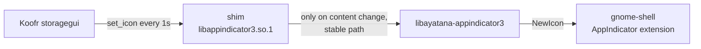

# koofr-tray-dedup

Stops the [Koofr](https://koofr.eu) Linux desktop client from flooding the tray with identical icon updates. On GNOME, those updates can drive `gnome-shell` to 100% CPU and freeze the desktop.

## Problem

The Koofr client (checked with build `41a82e7`) calls `app_indicator_set_icon_full` and `app_indicator_set_attention_icon_full` about once a second, even when idle and with an unchanged icon. Each call writes the icon to a new `/tmp/systray_XXXXXX` file and deletes the previous one.

The [AppIndicator GNOME extension](https://github.com/ubuntu/gnome-shell-extension-appindicator) (`ubuntu-appindicators@ubuntu.com` on Ubuntu) reloads the icon on every `NewIcon` signal, reading the path asynchronously. It regularly finds the file already deleted or half written:

```
systray unable to update icon: GdkPixbuf.PixbufError: Failed to recognize image format
```

After a suspend/resume, this has left gnome-shell spinning at 100% CPU until Koofr was killed.

## Fix

A small replacement `libappindicator3.so.1`. Koofr loads that library name first at runtime and falls back to `libayatana-appindicator3.so.1` when it's missing. The shim:

- forwards Koofr's six `app_indicator_*` calls to the real Ayatana library;
- passes an icon on only when its **content** changes;
- hands the tray a stable, content-addressed copy under `$XDG_RUNTIME_DIR/koofr-tray-dedup/`, so the path stays valid after Koofr deletes its temp file.

The Koofr binary is not modified, so the shim keeps working when Koofr updates itself.



## Install

Requires `gcc`, `make` and `libayatana-appindicator3-1` (already present if Koofr shows a tray icon).

```sh
./install.sh
```

This installs the library to `~/.local/lib/koofr-tray-dedup/` and changes the `Exec=` line of `~/.config/autostart/koofr.desktop` to (with `$HOME` written out, since desktop files do not expand variables):

```
Exec=env LD_LIBRARY_PATH=$HOME/.local/lib/koofr-tray-dedup $HOME/.koofr-dist/storagegui
```

Then quit Koofr and start it again through that line, or log out and back in.

If Koofr rewrites its autostart entry (e.g. when you toggle "start on login" in its settings), run `./install.sh` again.

## Verify

```sh
grep koofr-tray-dedup /proc/$(pgrep -x storagegui)/maps          # shim loaded
timeout 10 dbus-monitor --session \
  "type='signal',interface='org.kde.StatusNotifierItem'" | grep -c NewIcon   # ~0, was ~10
```

## Uninstall

Restore `Exec=$HOME/.koofr-dist/storagegui` in `~/.config/autostart/koofr.desktop`, then remove `~/.local/lib/koofr-tray-dedup/`.
